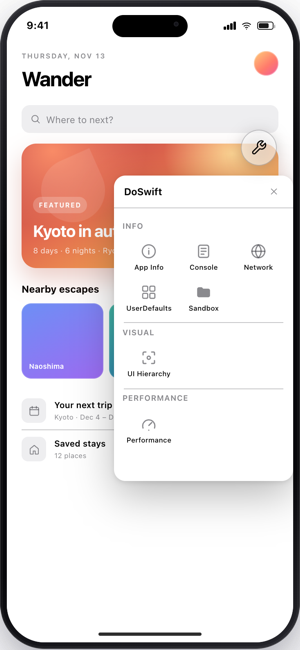
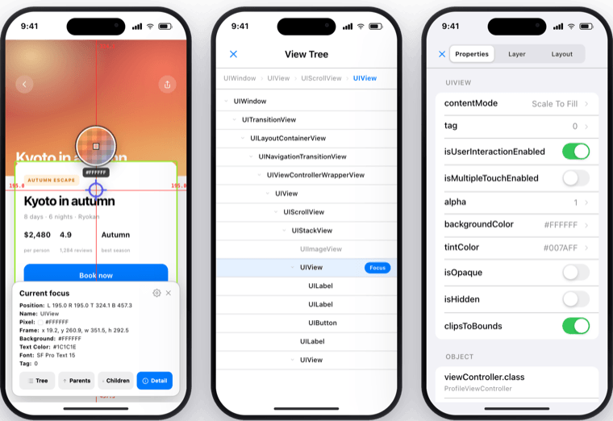

# DoSwiftKit: 专注于原生开发的纯净调试工具

## 特性

[DoSwiftKit](https://darkthanblack.github.io/DoSwiftKit/) 是

* 一个干净、克制的纯 Swift 调试工具包，来自对 [DoKit](https://github.com/didi/DoKit) 的彻底重新设计和实现
* 可以实时检视视图树、直接修改属性，同时提供 沙盒 / 日志 / 性能 等常用能力
* 无依赖 / 无上报 / iOS 13+ / 一行接入

## 预览

  

## 更多

建议您访问 [可交互的原型](https://darkthanblack.github.io/DoSwiftKit/) 或 [Github 主页](https://github.com/darkThanBlack/DoSwiftKit) 获取更多信息。

再次感谢您的阅读。

---

# DoSwiftKit: A Clean Debugging Toolkit for Native Development

## Features

[DoSwiftKit](https://darkthanblack.github.io/DoSwiftKit/) is

* A clean, restrained, pure-Swift debugging toolkit — a ground-up redesign and implementation of [DoKit](https://github.com/didi/DoKit)
* Inspect the view tree and edit properties live, alongside everyday tools for sandbox / console / performance and more
* No dependencies / no telemetry / iOS 13+ / one-line setup

## Preview

  

## More

See the [interactive prototype](https://darkthanblack.github.io/DoSwiftKit/) or the [GitHub repository](https://github.com/darkThanBlack/DoSwiftKit) for more information.

Thanks for reading.
